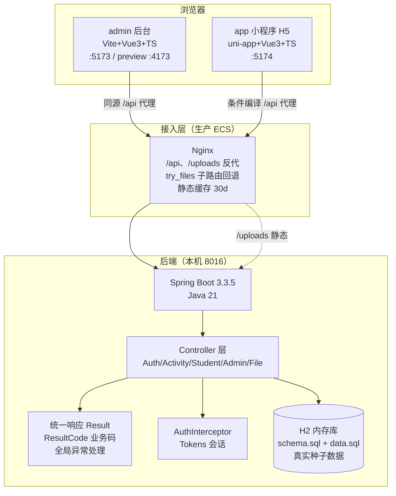

# 答辩材料

## 一、系统架构图

## 二、3 分钟演示脚本（真实可复现）

| 时间 | 操作 | 展示点 | 截图/证据 |
| --- | --- | --- | --- |
| 0:00-0:25 | `mvn spring-boot:run` 起 8016，`curl /api/ping` | 后端真实启动、统一响应 code=0 | S1-3 / S1-4 |
| 0:25-0:55 | 浏览器开 admin :5173，admin/admin123 登录 | 登录态 Pinia + token 注入 | S2-3 登录 |
| 0:55-1:20 | 工作台 `/` → 活动管理 `/activities` → 审核 `/audit` | 真实 SQL 统计、子路由可访问 | S2-3 / S4-5 |
| 1:20-1:45 | 学生 H5 :5174 登录 → 活动列表 → 报名 102 → 我的报名 → 签到（码 CK-2026-102） | 主链路 5 步、真实写库 | S3-2 |
| 1:45-2:10 | 触发名额满（报名 103 用 2024001003）、错误签到码 | 业务码 30001/40001 用户可读提示 | S3-3 |
| 2:10-2:30 | 学生令牌手输 admin `/users` | 403 前端拦截 + 后端 10002 | S3-4 |
| 2:30-2:50 | `bash scripts/smoke.sh` | PASS=18 FAIL=0 冒烟全绿 | S4-3 |
| 2:50-3:00 | 展示 README 五要素 + `pnpm build` / `pnpm build:h5` 产物 | 双端构建成功、可复现 | S4-1 / S4-6 |

## 三、技术取舍（3 处，讲清为什么）

1. **H2 内存库代替 MySQL/Redis**：本轮是前端工程化复现，后端课程负责持久化/缓存/Token 下发。H2 随进程由 SQL 重建，保证任何人按 README 一条命令即可获得一致数据，避免「mock 截图」与真实数据脱节；Redis 缓存、短信网关在本机用自签验证码 + ConcurrentHashMap 等效并明确标注，不冒充真实网关。
2. **uni-app H5 用同源 `/api` 代理而非硬编码域名**：`app/src/api/request.ts` 在 H5 下 `BASE_URL='/api'`，非 H5 端才用 `http://127.0.0.1:8016/api`；浏览器侧无跨域，部署时由 Nginx `/api` 统一反代，页面内不出现后端域名（评分项：无硬编码接口地址）。
3. **CJS/ESM 互操作归一化**（`app/vite.config.ts`）：`@dcloudio/vite-plugin-uni` 是 CJS 包，ESM 加载配置时默认导入是对象而非函数。用 `typeof` 判断归一化后 build:h5 成功——这是真实踩坑（BUG-10），保留修复而非绕过。

## 四、如何回答评审提问

- **"数据是不是 mock？"** → 不是。后端真实 H2 进程在 8016，`data.sql` 种子数据可用 SQL 查；所有页面数据经 `/api/*` 真实请求，Network 面板可核对。
- **"截图怎么证明是你自己跑的？"** → 主链路 5 张连续截图带时间戳 + 地址栏，冒烟输出 PASS=18 可现场重跑。
- **"为什么没上云？"** → 本机无 ECS/云效资源，部署资产（Nginx/systemd/YAML）已就位且配置正确，本机用 vite preview 验证子路由刷新不 404；不谎称已上线（README 已标注）。
